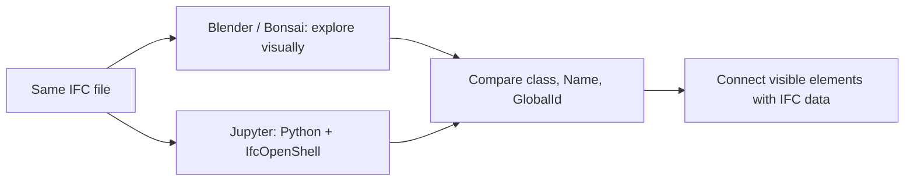

**Group 41 · DTU 41934 · A3: Teach**
# Getting Started with IFC Models Using Blender and Python

## Summary

A beginner-friendly introduction to exploring IFC models with Blender/Bonsai and reading basic building information using Python and IfcOpenShell. A companion Jupyter notebook connects visual model exploration with practical exercises in identifying building elements and their data.

## About the tutorial: the learning need

Starting with IFC models can feel overwhelming when BIM software and programming are unfamiliar. The course offers useful explanations and exercises across several pages. Our tutorial brings the first steps together in one accessible starting point, with links to explore further.

**Target audience:** future BIM Analyst course students with little or no experience in IFC, Blender/Bonsai, Python, or IfcOpenShell. Allow about 30–45 minutes for the notebook after setup.

## Target role and level

**OpenBIM Analyst — introductory preparation toward Level 2**, retaining the group's chosen role and intended level. The [course role description](https://timmcginley.github.io/41934/Roles/Analyst.html) includes GUI property-set analysis and scripting inside Blender/Bonsai at Level 2. This tutorial teaches earlier foundations: element identities in the GUI and basic Python queries in Jupyter. Completing it alone does not cover the entire Level 2 description.

## Focus area and BIM use

**Focus area:** Build. **BIM use:** reviewing a building model; gathering and communicating element information. Learners identify building components and connect their visual appearance to IFC class, Name, and GlobalId. The tutorial stays focused on introductory model exploration.

## What you will learn

1. Understand the basic purpose of IFC and OpenBIM.
2. Open and navigate an IFC model in Blender/Bonsai.
3. Open an IFC file using Python and IfcOpenShell.
4. Identify and count elements using IFC classes.
5. Retrieve names and GlobalIds.
6. Relate a 3D element to its underlying IFC data.

## Tutorial formats

- **Jupyter notebook:** [A3_tutorial.ipynb](A3_tutorial.ipynb), preserving the group's original open/count/read/try sequence. Exercise 5 connects Python output with a manually selected element in Bonsai, followed by an independent column challenge.
- **Markdown README:** setup, scope, model information, and references.
- **Planned video (5–6 minutes):** a visual overview complementing the notebook. **Video link: TODO — not yet recorded or published.**

## Workflow



## Before you start

You need:

- **Python 3** with a version supported by the [IfcOpenShell installation instructions](https://docs.ifcopenshell.org/ifcopenshell-python/installation.html).
- **Jupyter Notebook**, or VS Code with Python and Jupyter extensions and a selected Python kernel.
- **IfcOpenShell**, the only additional library used by the tutorial code.
- **Blender and Bonsai**, installed using the [official Bonsai installation guide](https://docs.bonsaibim.org/studio/quickstart/installation.html). Bonsai's own Python environment is separate from your Jupyter environment.
- The supplied `B308X.ifc` model.

Git or GitHub Desktop is optional if you already have the files; downloading the repository ZIP also works. `requirements.txt` retains the group's existing dependencies: `ifcopenshell` and `jupyter`.

## Instructions to run the tutorial

1. Open this cloned repository in VS Code. Confirm these files are together:

   ```text
   A3/
     A3_tutorial.ipynb
     B308X.ifc
     README.md
     requirements.txt
   ```

2. Open `A3_tutorial.ipynb` and use **Select Kernel** to choose your Python environment. Follow any prompts to install the Python/Jupyter extensions or kernel support.
3. Alternatively, open a terminal in `A3` and run:

   ```bash
   python -m pip install -r requirements.txt
   python -m notebook A3_tutorial.ipynb
   ```

   Use `python3` if that is your system's Python command. Jupyter opens in the browser; select a Python 3 kernel.
4. Read each Markdown explanation, then run code cells in order with **Shift + Enter**. Outputs appear below. If you restart the kernel, rerun the earlier cells.
5. If IfcOpenShell is missing from your selected kernel, the notebook contains an optional `%pip install ifcopenshell` instruction. Restart the kernel if prompted. Installing Bonsai alone does not install IfcOpenShell into Jupyter.
6. The default `IFC_FILE = "B308X.ifc"` assumes Python's working folder is `A3`. If running from the repository root, set it to `"A3/B308X.ifc"`. Use the same file in Bonsai for Exercise 5.

## Example IFC model

`B308X.ifc` is the existing example from this group's GitHub repository, restored unchanged into this local checkout. It is about 21.7 MB; it was not generated or edited for this revision. Upstream reference: `origin/main` at `9a275ea`, model Git blob `d54392a8ce4eeaf8bb5dbd5d3785e228d22d4a21`.

Verified with IfcOpenShell 0.9.0.post1 on 3 November 2026:

| Check | Result |
| --- | --- |
| IFC schema | `IFC4X3` |
| `IfcWall` | 149 |
| `IfcDoor` | 101 |
| `IfcColumn` | 211 |

The first wall has name `Basic Wall:BA_Heavy Weight_Concrete_200mm:1794121` and GlobalId `2xflkD7IDEMgp51ZbDNMUT`. Its spatial container is `ES_Stue`; its name occurs once among the model's `IfcElement` objects and it has a geometric representation. This supplies a concrete target for Exercise 5. The notebook explains how to locate it and compare its class, Name, and GlobalId.

Counts and the example identity apply to this file. Other models or revisions may differ; names can be missing or repeated. The model's original provenance and redistribution permission are not documented here; the group should confirm these before distributing teaching materials beyond the existing repository.

## Resources

The tutorial builds on existing course materials. Links checked on 3 November 2026:

- [Course home](https://timmcginley.github.io/41934/) and [A3: Teach requirements](https://timmcginley.github.io/41934/Assignments/A3.html).
- [OpenBIM concepts](https://timmcginley.github.io/41934/Concepts/OpenBIM.html) and [IFC concepts](https://timmcginley.github.io/41934/Concepts/IFC.html).
- [Getting started with Blender/Bonsai](https://timmcginley.github.io/41934/Concepts/Bonsai/index.html).
- [Introduction to Python activity](https://timmcginley.github.io/41934/Activities/IntrotoPython.html).
- [IfcOpenShell concepts](https://timmcginley.github.io/41934/Concepts/IfcOpenShell/index.html) and [basic IfcOpenShell examples](https://timmcginley.github.io/41934/Examples/IfcOpenShell/Basic.html).
- [System environment scripting activity](https://timmcginley.github.io/41934/Activities/SystemEnvScriptIntro.html), [classification in Blender/Bonsai](https://timmcginley.github.io/41934/Activities/BlenderClassification.html), and [Blender scripting introduction](https://timmcginley.github.io/41934/Activities/BlenderScriptIntro.html).
- [IfcOpenShell: Hello, world!](https://docs.ifcopenshell.org/ifcopenshell-python/hello_world.html).
- [Bonsai model exploration guide](https://docs.bonsaibim.org/studio/quickstart/explore_model.html), documentation labelled 0.9.0post1, used for the manual GUI instructions.

## A3 preparation and remaining group work

The [official assignment](https://timmcginley.github.io/41934/Assignments/A3.html) asks for a learning need, objectives, role/level, focus and BIM use, an explicit brief summary, peer testing, and peer feedback. This README and notebook provide two complementary formats; the planned video will add a visual overview.

- Confirm the learning need and intended level with the focus area; record the proposing person/group if known. Learning-need owner: **TODO — group to confirm**.
- Walk through Exercise 5 in your installed Blender/Bonsai version. Its instructions follow official documentation but have not been tested in a live GUI. Add the requested selected-wall screenshot and record the versions used.
- Ask a beginner peer to run the notebook from a fresh kernel. Record confusing steps and revise them. Peer test/feedback: **TODO**.
- Arrange the required focus-area presentation and provide feedback to at least two other groups; retain feedback and reflections for A5.
- Record the future video, then replace the placeholder with its permanent link. Suggested coverage: tools/context, opening and navigating the model, one short Python query, and matching its GlobalId visually. Leave extended practice in the notebook.

The code cells have been executed sequentially against the supplied model, and the notebook format has been validated. Code checks do not replace the manual GUI walkthrough or beginner peer test.
