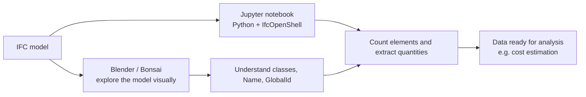

**Group 41 DTU 41934**
# Getting Started with IFC Models Using Blender and Python


## Summary

A beginner-friendly introduction to exploring IFC models with Blender/Bonsai and extracting basic building information using Python and IfcOpenShell. A short video and companion Jupyter notebook connect the essential concepts with practical examples.

## About the tutorial

Starting with IFC models can feel overwhelming when BIM software and programming are unfamiliar. The course offers useful explanations and exercises across several pages. Our tutorial aims to bring the first steps together in one accessible starting point, with links to explore further.

It is intended for future course students with **little or no experience in BIM software or Python.**

## Focus area and BIM use
**Focus area:** Build

**BIM use:** Cost Estimation

Every cost estimation starts by knowing what is in the model: which elements exist, how many there are and what their characteristics are. This tutorial teaches that first step. Students learn how to find elements in an IFC model, read their identity (class, Name, GlobalId) and extract quantities, which is the information a quantity take-off and a cost estimation tool depend on.

## What you will learn

- Understand what an IFC model contains and how the tools work together.
- Open an IFC model in Blender/Bonsai and navigate the building.
- Select elements and inspect their IFC class, Name, and GlobalId.
- Open an IFC file using Python and IfcOpenShell.
- Count elements and extract basic information.
- Extarct element quantitites as a first step towards cost estimation.

## Tutorial formats

- **Video (5–6 minutes):** A visual overview of the tools and a demonstration of model exploration and simple queries. Watch it here: [link del video].
- **Jupyter notebook:** Step by step explanations, simple Python examples, and exercises for independent practice. Open it here: [link del notebook].

## Workflow of the application



## Instructions to Run the Tutorial

**Setup:**
1. Clone the repository:
```bash
git clone https://github.com/ivannaloria/BLD_26_41.git
```

2. Go to the A3 folder:
```
cd BLD_26_41/A3
```
3. Install the dependencies:
```
pip install -r requirements.txt
```
4. Open the notebook:
```
jupyter notebook A3_tutorial.ipynb
```
5. Watch the video and follow the notebook cell by cell.

## Resources

The tutorial will build on existing materials:

- [IFC concepts](https://timmcginley.github.io/41934/Concepts/IFC.html)
- [Getting started with Bonsai](https://timmcginley.github.io/41934/Concepts/Bonsai/index.html)
- [Blender scripting introduction](https://timmcginley.github.io/41934/Activities/BlenderScriptIntro.html)
- [Basic IfcOpenShell examples](https://timmcginley.github.io/41934/Examples/IfcOpenShell/Basic.html)
- [IfcOpenShell: Hello, world!](https://docs.ifcopenshell.org/ifcopenshell-python/hello_world.html)

